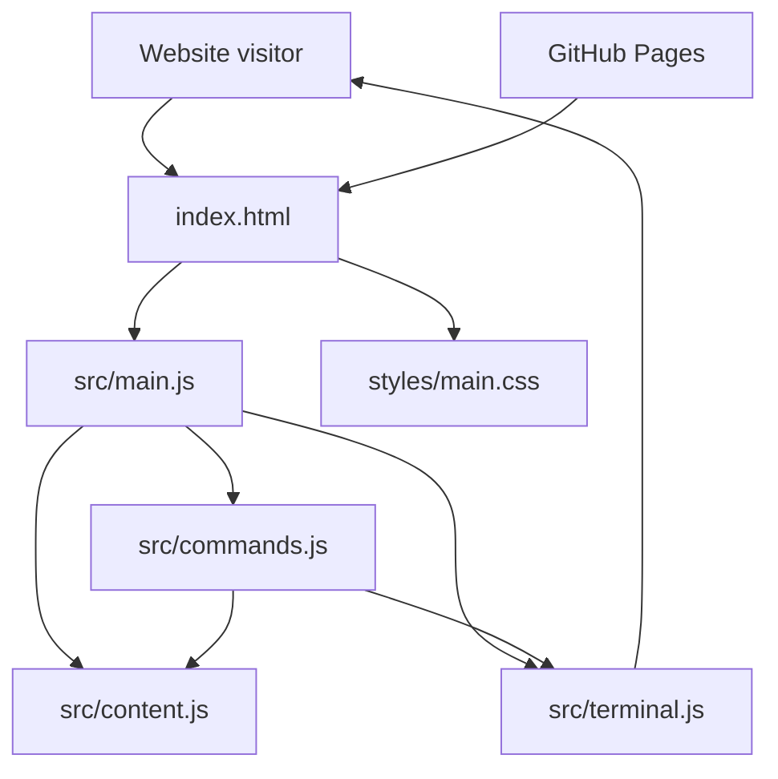

# Prabhakar R — Terminal Portfolio

An interactive, terminal-style personal portfolio for **Prabhakar Ravichandran**, a Computer Science and Engineering student from Chennai, Tamil Nadu, India.

The project presents portfolio information through a command-line-inspired interface in the browser. Visitors can enter commands to explore professional information, skills, education, experience, projects, resume, and contact links.

- **Live website:** https://prabhakarravichandran.github.io/prabhakar-terminal-portfolio/
- **GitHub repository:** https://github.com/PrabhakarRavichandran/prabhakar-terminal-portfolio
- **LinkedIn:** https://www.linkedin.com/in/prabhakar-ravichandran

---

## Table of Contents

- [Overview](#overview)
- [Features](#features)
- [Technology Stack](#technology-stack)
- [Project Structure](#project-structure)
- [Architecture](#architecture)
- [Terminal Commands](#terminal-commands)
- [Getting Started](#getting-started)
- [Deployment](#deployment)
- [Customization](#customization)
- [Testing Checklist](#testing-checklist)
- [Troubleshooting](#troubleshooting)
- [Future Improvements](#future-improvements)
- [Author](#author)
- [License and Attribution](#license-and-attribution)

## Overview

Traditional portfolios often present information through static sections and navigation menus. This project takes a different approach: it uses a terminal-inspired interface where visitors explore content by entering commands.

The design combines a dark terminal window, monospaced typography, a command prompt, and a custom ASCII-art name banner. The goal is to make portfolio browsing interactive while keeping the underlying information accessible.

### Project goals

- Present professional and academic information in a memorable format.
- Provide a lightweight web experience using standard frontend technologies.
- Make portfolio sections discoverable through simple terminal commands.
- Keep the interface responsive and easy to navigate.
- Publish the portfolio through GitHub Pages.

## Features

- **Interactive terminal interface** for command-based browsing.
- **Custom ASCII name banner** intended to display `PRABHAKAR` clearly.
- **Essential help menu** with a compact, organized command list.
- **Portfolio content sections** for about, skills, education, experience, projects, resume, contact, and social profiles.
- **Simulated filesystem commands** for listing files, changing directories, reading content, and checking the current directory.
- **Keyboard interaction**, including command history and tab completion where implemented.
- **Responsive styling** for desktop and smaller screens.
- **GitHub Pages deployment workflow** stored in `.github/workflows/deploy.yml`.

> Feature availability should be checked against the current implementation in `src/commands.js` and `src/terminal.js`.

## Technology Stack

| Technology | Purpose |
|---|---|
| HTML5 | Page structure |
| CSS3 | Terminal appearance, layout, and responsive styling |
| JavaScript | Command handling, terminal interactions, and content rendering |
| Git | Version control |
| GitHub | Source-code hosting |
| GitHub Pages | Static website hosting |
| GitHub Actions | Automated deployment workflow |

The repository structure indicates a static frontend project. No backend service or frontend framework is required by the documented project structure.

## Project Structure

```text
prabhakar-terminal-portfolio/
├── .github/
│   └── workflows/
│       └── deploy.yml       # GitHub Actions Pages deployment workflow
├── src/
│   ├── commands.js           # Terminal command definitions and handlers
│   ├── content.js            # Portfolio content and simulated filesystem data
│   ├── main.js               # Application entry point and initialization
│   └── terminal.js           # Terminal rendering and interaction behavior
├── styles/
│   └── main.css              # Terminal styling and responsive layout
├── .gitignore                # Files excluded from Git
├── index.html                # Main application page
└── README.md                 # Project documentation
```

The files are organized by responsibility so command behavior, portfolio content, terminal interaction, and styling can be maintained separately.

## Architecture

### High-level architecture



### Component responsibilities

| Component | Responsibility |
|---|---|
| `index.html` | Provides the page structure and loads the application assets |
| `src/main.js` | Initializes the application and connects its parts |
| `src/commands.js` | Defines how supported terminal commands are processed |
| `src/content.js` | Stores portfolio content and simulated filesystem information |
| `src/terminal.js` | Manages terminal output and user interaction |
| `styles/main.css` | Defines visual presentation and responsive behavior |
| `deploy.yml` | Automates the GitHub Pages deployment process |

This diagram describes the intended separation based on the project file structure; implementation details may evolve as the code changes.

## Terminal Commands

Type `help` in the terminal to see the supported essential commands.

### Essential commands

| Command | Purpose |
|---|---|
| `help` | Display the available command list |
| `about` | Read the professional introduction |
| `skills` | Explore technical skills |
| `education` | View educational background |
| `experience` | View training and experience |
| `projects` | Explore portfolio projects |
| `resume` | Open or download the resume, depending on implementation |
| `contact` | View contact information |
| `socials` | View professional profiles |
| `clear` | Clear terminal output |

### Navigation commands

| Command | Purpose |
|---|---|
| `ls` | List files in the current or specified directory |
| `cd <dir>` | Navigate to a simulated directory |
| `cat <file>` | Display the contents of a simulated file |
| `pwd` | Display the current simulated directory |

Keyboard features such as arrow-key command history and tab completion are available where implemented.

## Getting Started

### Prerequisites

- A modern web browser.
- Git, if you want to clone the repository.
- A local static web server for a more representative development preview (recommended).

No package manager or build step is indicated by the current repository structure.

### Clone the repository

```powershell
git clone https://github.com/PrabhakarRavichandran/prabhakar-terminal-portfolio.git
cd prabhakar-terminal-portfolio
```

### Run locally

You can open `index.html` in a browser for a quick check. If browser restrictions affect local assets or scripts, use a local static server instead.

For example, if Python is installed:

```powershell
python -m http.server 8000
```

Then visit `http://localhost:8000`.

Stop the local server with `Ctrl+C`.

## Deployment

The project includes a GitHub Actions workflow at `.github/workflows/deploy.yml`. The published website is intended to use GitHub Pages.

### GitHub Pages configuration

1. Open the repository on GitHub.
2. Go to **Settings → Pages**.
3. Under **Build and deployment**, choose **GitHub Actions** if the workflow is responsible for deployment.
4. Open the **Actions** tab and confirm that the deployment workflow completes successfully.
5. Visit the live website URL listed at the top.

If deployment fails, open the failed workflow run and inspect the first failed step. Verify that Pages is enabled, the workflow has the required permissions, and the workflow configuration matches GitHub Pages' current requirements.

### Publish changes

From the project directory:

```powershell
git status
git add .
git commit -m "Describe your changes"
git push origin main
```

Review staged files before committing and never include credentials, private keys, or other sensitive information.

## Customization

### Update portfolio information

Review `src/content.js` to locate the portfolio text and simulated filesystem content. Update the existing data structures rather than duplicating content in multiple files.

### Add or modify terminal commands

Review `src/commands.js`. Follow the existing command-registration and handler patterns so new commands work with the terminal's current input, output, and navigation behavior.

### Adjust terminal behavior

Review `src/terminal.js` for command input, output rendering, keyboard interaction, history, and completion logic.

### Change the visual design

Review `styles/main.css` for colors, typography, terminal dimensions, spacing, responsive rules, and the ASCII banner's presentation.

### Update the page shell

Use `index.html` for the main document structure and asset references. Keep asset paths compatible with the repository's GitHub Pages project URL.

## Testing Checklist

- [ ] The website loads without browser-console errors.
- [ ] The name banner clearly spells `PRABHAKAR`.
- [ ] `help` shows a compact and readable command list.
- [ ] Essential portfolio commands return the expected content.
- [ ] `ls`, `cd`, `cat`, and `pwd` behave as expected.
- [ ] `clear` clears the terminal output.
- [ ] Command history and tab completion work where supported.
- [ ] Resume, contact, and social links point to the intended destinations.
- [ ] The terminal remains readable on desktop and mobile.
- [ ] No horizontal overflow or clipped banner characters appear.
- [ ] The GitHub Actions workflow succeeds after pushing.
- [ ] The live GitHub Pages website reflects the latest changes.

## Troubleshooting

### The page does not load correctly

- Confirm that `index.html` is at the repository root.
- Check browser developer tools for missing files or JavaScript errors.
- Verify asset paths and capitalization.

### Terminal commands do not respond

- Check the browser console.
- Inspect command registration in `src/commands.js`.
- Confirm application initialization in `src/main.js`.
- Check input and event handling in `src/terminal.js`.

### The ASCII banner looks distorted

- Use a monospaced font.
- Check spacing and line lengths in the banner.
- Test at narrow viewport widths.
- Avoid relying on spaces that collapse in HTML; preserve whitespace through appropriate CSS or markup.

### GitHub Pages deployment fails

- Open the repository's **Actions** tab.
- Open the failed workflow run and read the first failed step.
- Confirm **Settings → Pages → Build and deployment → Source** matches the workflow.
- Review workflow permissions and deployment configuration before changing code.

### The live site does not show the latest commit

- Confirm the latest commit was pushed to `main`.
- Check whether the deployment workflow completed successfully.
- Wait briefly for the Pages deployment and browser cache to update.

## Future Improvements

Possible enhancements include:

- Improved command suggestions and contextual help.
- Additional accessibility checks and keyboard guidance.
- More robust small-screen handling for the ASCII banner.
- Automated tests for command parsing and navigation.
- A lightweight continuous-integration check for JavaScript errors.
- A clear not-found response for unsupported commands.
- Better documentation for the simulated filesystem and command syntax.

These are possible future enhancements, not claims that they are already implemented.

## Author

**Prabhakar Ravichandran**  
Computer Science and Engineering student  
Chennai, Tamil Nadu, India

- GitHub: https://github.com/PrabhakarRavichandran
- LinkedIn: https://www.linkedin.com/in/prabhakar-ravichandran
- Email: raviprabahar2006@gmail.com

## License and Attribution

This portfolio is inspired by the terminal-style presentation approach of [codebytere](https://codebytere.re). The project README previously described the reference as MIT-licensed; verify the original repository's current license and retain any required attribution or license notices before redistributing derived material.

The portfolio's own license should be stated explicitly in a `LICENSE` file if you intend to grant reuse permissions. Do not assume that the reference project's license automatically defines the license for all original content in this repository.
